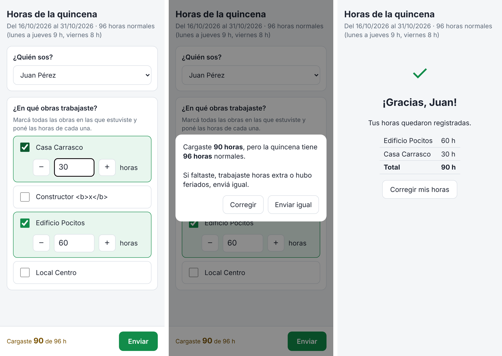

# Horas por obra — Cubells

Los trabajadores cargan desde el celular las horas de la quincena en cada obra, y la planilla
arma sola el resumen por obra con los conceptos para sueldos.

## Cómo funciona

1. **Pedir las horas.** Desde la planilla (menú **Horas → 1. Preparar mensajes de WhatsApp**) se
   genera el mensaje con el link. Se manda por WhatsApp: al grupo, o a cada trabajador con un
   botón **Enviar** que abre WhatsApp con el mensaje ya escrito.
2. **El trabajador responde.** Toca el link y se abre el formulario. Elige su nombre, marca una o
   varias obras y pone las horas de cada una. Si trabajó en una obra que no está en la lista, la
   agrega con **+ Otra obra** escribiendo el nombre (queda como "Otra: …"). Las **horas extra** de
   la quincena van en un renglón aparte. Si el total no coincide con el horario normal de la
   quincena, se le avisa antes de enviar. Si se equivocó, puede volver a entrar y corregir: la
   respuesta nueva reemplaza a la anterior.
3. **Descargar el resumen.** En la hoja **Control** se ve quién falta responder. Cuando están
   todos, **Horas → 3. Descargar Excel**.

### Conceptos

| Concepto | Cálculo (por trabajador y por obra) |
|---|---|
| Ropa | horas |
| Transporte | horas |
| Herramientas | horas |
| Ticket alimentación | horas ÷ 8 |
| Descanso pago | horas ÷ 8 |
| Viático | horas ÷ 8 |

**Horas extra:** se muestran aparte (hojas Detalle, Control y al pie del Resumen por obra); no se
suman a las obras ni a los conceptos.

**Horario normal:** lunes a jueves 9 h, viernes 8 h. Se usa para controlar el total de cada
trabajador (hoja **Control**). Los feriados que se anotan en **Configuración** no se cuentan.

### Hojas de la planilla

| Hoja | Para qué |
|---|---|
| Configuración | Fechas de la quincena, link del formulario, texto del mensaje, feriados. |
| Obras | Lista de obras. Solo aparecen en el formulario las que tienen **Activa** tildada. |
| Trabajadores | Nombre, celular y **Activo**. La herramienta completa el código, el link personal y el botón **Enviar**. |
| Respuestas | Todo lo que mandan los trabajadores (un renglón por obra). Queda el historial de todas las quincenas. |
| Resumen por obra | Suma de todos los trabajadores por obra, con los conceptos y el total. |
| Detalle por trabajador | Horas y conceptos de cada trabajador en cada obra. |
| Control | Quién respondió, horas cargadas contra horas normales de la quincena. |

## Cómo está armado

- **La planilla de Google** guarda todo y hace los cálculos (código en `apps-script/Codigo.gs`).
- **La página del formulario** (`docs/`) está publicada en GitHub Pages. Le habla a la planilla
  sin usar las cuentas de Google del celular: así funciona aunque el trabajador tenga varias
  cuentas de Google abiertas (con el formulario servido directo desde Google eso fallaba).
- `docs/config.js` tiene el link de la implementación web del Apps Script.

## Instalación (una sola vez)

Hace falta una cuenta de Google y hacerlo desde una computadora.

1. **Crear la planilla.** Entrar a [sheets.new](https://sheets.new), ponerle un nombre y en
   **Archivo → Configuración** elegir la zona horaria **Montevideo**.
2. **Pegar el código.** **Extensiones → Apps Script**. En `Código.gs` borrar todo y pegar el
   contenido de [`apps-script/Codigo.gs`](apps-script/Codigo.gs). Guardar.
3. **Instalar las hojas.** Elegir la función `instalar` y tocar **▶ Ejecutar**. Aceptar los
   permisos (*Configuración avanzada → Ir a … (no seguro) → Permitir*).
4. **Publicar el Apps Script.** **Implementar → Nueva implementación → Aplicación web**,
   *Ejecutar como*: **Yo**, *Quién tiene acceso*: **Cualquier usuario**. Copiar la URL (termina
   en `/exec`) y ponerla en `docs/config.js`.
5. **Publicar la página.** En GitHub, en el repositorio: **Settings → Pages → Build and
   deployment**: *Source* **Deploy from a branch**, elegir la rama y la carpeta **/docs**, **Save**.
   (GitHub Pages gratis requiere que el repositorio sea público; el repositorio solo tiene código,
   ningún dato de la planilla.) A los minutos queda en
   `https://estudioperdomo23-create.github.io/Toma-de-datos-para-sueldos-cubells/`.
6. **Pegar el link de la página** en la planilla, hoja **Configuración**, *Link del formulario*.
7. **Cargar los datos** en **Obras** y **Trabajadores** (tildar *Activa* / *Activo*).

## Uso cada quincena

1. **Horas → Pasar a la quincena siguiente** (o cambiar las fechas en **Configuración**). Anotar
   los feriados de la quincena, si hay.
2. **Horas → 1. Preparar mensajes de WhatsApp**.
   - *Al grupo:* copiar el mensaje que aparece y pegarlo en el grupo. Cada uno elige su nombre.
   - *A cada uno:* en **Trabajadores**, tocar **Enviar** en cada fila. Con el link personal el
     formulario ya sabe quién es y nadie puede cargar por otro.
3. Mirar la hoja **Control** para ver quién falta y recordarle.
4. **Horas → 3. Descargar Excel**.

Las respuestas de quincenas anteriores no se pierden: para ver de nuevo un resumen viejo, poner
esas fechas en **Configuración** y usar **Horas → 2. Actualizar resumen**.

## Cambios en el código

Si se modifica `Codigo.gs` después de publicar: **Implementar → Gestionar implementaciones → ✏️ →
Versión: Nueva versión → Implementar**. La URL no cambia, así que `docs/config.js` sigue igual.
Si en cambio se crea una implementación nueva, hay que poner su URL en `docs/config.js`.

Pruebas automáticas (simulan la planilla): `npm test` (Node 18 o superior).
